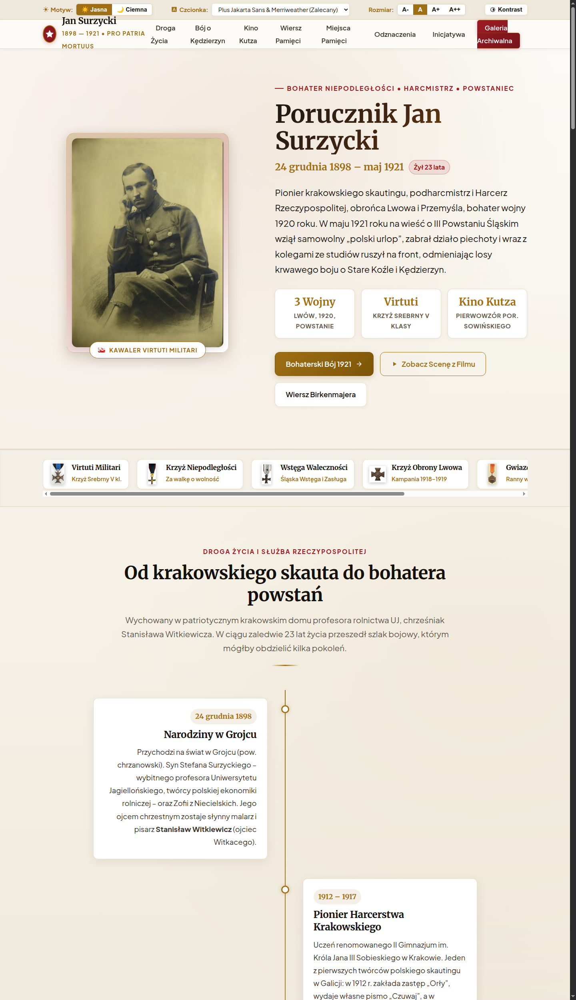

# Jan Surzycki (1898–1921)

Strona pamięci poświęcona **Janowi Surzyckiemu** (1898–1921) — krakowskiemu harcerzowi, obrońcy Przemyśla i Lwowa, uczestnikowi III powstania śląskiego, poległemu pod Starym Koźlem 9 maja 1921 r.



## Zawartość portalu

- **Życiorys** — droga od harcerstwa krakowskiego, przez walki o Przemyśl i Lwów (1918), wojnę polsko-bolszewicką, aż po III Powstanie Śląskie.
- **Maj 1921** — przebieg walk pod Kędzierzynem i Starym Koźlem, okoliczności bohaterskiej śmierci na czele plutonu.
- **Pogrzeb w Krakowie** — uroczysty pochówek na Cmentarzu Rakowickim (16 maja 1921), manifestacja patriotyczna młodzieży i mieszkańców Krakowa.
- **Film i materiały wideo** — archiwalne nagrania, film dokumentalny „Sól Ziemi Czarnej / Jan Surzycki”.
- **Wiersz i pamiątki** — wiersz poświęcony pamięci bohatera, wyciągi ze wspomnień i pamiętników.
- **Miejsca pamięci** — grobowiec rodzinny Surzyckich na Cmentarzu Rakowickim w Krakowie, tablica w II LO im. Króla Jana III Sobieskiego, mogiła w Starym Koźlu.
- **Archiwum dokumentów** — skany dokumentów wojskowych, odznaczeń (Krzyż Srebrny Orderu Virtuti Militari, Krzyż Niepodległości z Mieczami, Krzyż Obrony Lwowa, Gwiazda Przemyśla), artykułów prasowych z 1921 r.

## Uruchomienie lokalne

Wystarczy otworzyć plik `index.html` w dowolnej przeglądarce internetowej lub uruchomić skrypt:

```bash
./uruchom_strone.sh
```

Strona jest w pełni statyczna (HTML5, CSS3, czysty JavaScript), responsywna i posiada przełącznik motywu jasnego/ciemnego oraz regulację rozmiaru tekstu.
